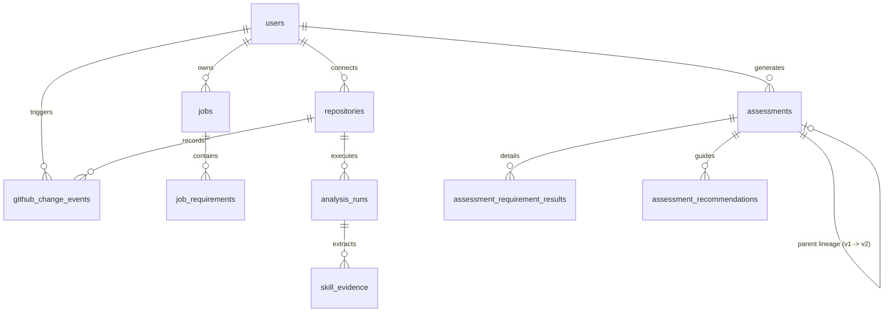

# Parivartan AI (परिवर्तन AI)

> **Evidence-Grounded AI Career Coach: Validating Software Engineering Competence via Real GitHub Commits, Vector RAG Code Verification, Deterministic Skill-Gap Scoring, and Continuous Change Detection.**

[](https://www.python.org/)
[](https://fastapi.tiangolo.com/)
[](https://react.dev/)
[](https://vitejs.dev/)
[](https://tailwindcss.com/)
[](https://www.trychroma.com/)
[](https://github.com/tesseract-ocr/tesseract)
[](https://supabase.com/)
[](#running-automated-tests)
[](LICENSE)

---

## Table of Contents

- [Overview & Value Proposition](#overview--value-proposition)
- [System Architecture & Data Flow](#system-architecture--data-flow)
- [Feature Deep-Dive](#feature-deep-dive)
  - [1. Multi-Modal Job Requirement Ingestion & OCR](#1-multi-modal-job-requirement-ingestion--ocr)
  - [2. Intelligent GitHub Portfolio Ingestion & Evidence Mining](#2-intelligent-github-portfolio-ingestion--evidence-mining)
  - [3. ChromaDB Retrieval-Augmented Generation (RAG) Subsystem](#3-chromadb-retrieval-augmented-generation-rag-subsystem)
  - [4. Deterministic Skill-Gap Assessment & Explainable Scoring](#4-deterministic-skill-gap-assessment--explainable-scoring)
  - [5. Autonomous GitHub Change Detection & Version Lineage](#5-autonomous-github-change-detection--version-lineage)
  - [6. Enterprise Security, Multi-Tenancy & Data Integrity](#6-enterprise-security-multi-tenancy--data-integrity)
  - [7. Modern White & Blue UI/UX Design System](#7-modern-white--blue-uiux-design-system)
- [Technology Stack](#technology-stack)
- [Database Schema & Migrations](#database-schema--migrations)
- [Complete REST API Reference](#complete-rest-api-reference)
- [Prerequisites & Installation](#prerequisites--installation)
  - [1. System Prerequisites](#1-system-prerequisites)
  - [2. Tesseract OCR Engine Setup](#2-tesseract-ocr-engine-setup)
  - [3. Backend Setup](#3-backend-setup)
  - [4. Frontend Setup](#4-frontend-setup)
  - [5. Background Worker Daemon](#5-background-worker-daemon)
- [Environment Configuration](#environment-configuration)
- [Running Automated Tests](#running-automated-tests)
- [Step-by-Step Live Demo Checklist](#step-by-step-live-demo-checklist)
- [Troubleshooting & FAQ](#troubleshooting--faq)
- [License](#license)

---

## Overview & Value Proposition

Traditional technical hiring relies on self-reported resumes and keywords, leading to resume exaggeration and subjective, opaque evaluations. **Parivartan AI** solves this problem by comparing real-world job requirements directly against **cryptographically verified GitHub repository evidence and commit history**.

### Core Differentiators

| Capability | Traditional Resume / ATS | Parivartan AI |
| :--- | :--- | :--- |
| **Evidence Basis** | Self-reported buzzwords & claims | Exact file paths, line ranges, AST structures, and commit SHAs |
| **Scoring Integrity** | Opaque black-box keyword matching | **100% deterministic mathematical formula** (zero LLM score fabrication) |
| **Document Ingestion** | Plain text copy-paste only | Multi-modal: Raw text, SSRF-safe URL fetching, and **PDF upload with selective Tesseract OCR** |
| **Code Verification** | None | **ChromaDB vector RAG** retrieval with line-level code citations and anti-hallucination audits |
| **Project Evolution** | Static snapshot | **Continuous background monitoring** detecting new commits and generating assessment version lineage (`v1` &rarr; `v2`) |
| **Multi-Tenancy** | Shared database storage | Complete **Supabase Row-Level Security (RLS)** tenant isolation |

---

## System Architecture & Data Flow

Parivartan AI employs an event-driven, decoupled client-server architecture backed by a vector database (ChromaDB) and a relational database (Supabase PostgreSQL):

```
                                  PARIVARTAN AI ARCHITECTURE
                                  
  ┌────────────────────────────────────────────────────────────────────────────────────────┐
  │                                    REACT 19 FRONTEND                                   │
  │   Vite 8 • Tailwind CSS v4 • Lucide React • Supabase Auth Context • Modern White & Blue │
  └────────────────────────┬───────────────────────────────────────┬───────────────────────┘
                           │ (Bearer Token / JWT)                  │ (Direct Auth / Session)
                           ▼                                       ▼
  ┌────────────────────────────────────────────────┐     ┌─────────────────────────────────┐
  │             FASTAPI PYTHON BACKEND             │     │          SUPABASE AUTH          │
  │  Pydantic v2 • Uvicorn • Async HTTPX Client    │     │  Sign up / Sign in / Session    │
  └───────┬────────────┬─────────────┬───────────┬─┘     └─────────────────────────────────┘
          │            │             │           │
          ▼            ▼             ▼           ▼
   ┌─────────────┐ ┌───────────┐ ┌─────────┐ ┌──────────────────────────────────────────────┐
   │ PyMuPDF +   │ │  GitHub   │ │ LLM API │ │             SUPABASE POSTGRESQL              │
   │ Tesseract   │ │ REST API  │ │ Gemini  │ │                                              │
   │ OCR Engine  │ │  Client   │ │ Flash   │ │  • public.jobs & job_requirements            │
   └─────────────┘ └─────┬─────┘ └─────────┘ │  • public.repositories & analysis_runs       │
                         │                   │  • public.skill_evidence                     │
                         ▼                   │  • public.assessments                        │
   ┌───────────────────────────────────────┐ │  • public.assessment_requirement_results     │
   │    CHROMADB PERSISTENT VECTOR STORE   │ │  • public.assessment_recommendations        │
   │  Cosine Embeddings • Code Chunker     │ │  • public.github_change_events               │
   │  Multi-tenant repo_id filtering       │ │  • Row-Level Security (RLS) on all tables   │
   └───────────────────────────────────────┘ └──────────────────────┬───────────────────────┘
                         ▲                                          │
                         │                                          │
   ┌─────────────────────┴──────────────────────────────────────────┴───────────────────────┐
   │                       AUTONOMOUS CHANGE DETECTOR WORKER DAEMON                         │
   │  workers/change_detector_worker.py • Polling Loop • Git Compare API • Idempotent Queue │
   │  Evidence Reconciliation • Auto-Reassessment Lineage Generation (v1 -> v2)             │
   └────────────────────────────────────────────────────────────────────────────────────────┘
```

### End-to-End Processing Lifecycle

```
[Job Posting (Text / PDF)]
           │
           ├──> (If PDF) Validate Magic Bytes (%PDF-) -> PyMuPDF Text Check -> Tesseract OCR if Scanned
           │                                                                    │
           ├──> Human-in-the-Loop Editable Preview & Confirmation <─────────────┘
           │
           └──> LLM Categorized Skill Extraction (Languages, Frameworks, DBs, DevOps, Concepts)
                                                                 │
                                                                 ▼
                                                  [Saved Job in Supabase PostgreSQL]
                                                                 │
                                                                 │ (Assessment Triggered)
                                                                 ▼
[User GitHub Repositories] ──> Bounded Tree Mining ──> ChromaDB Vector RAG ──> Grounded Matcher
                                                                 │
                                                                 ▼
                                           Deterministic Mathematical Score (0 - 100%)
                                           + Prioritized Gaps & Actionable Recommendations
                                                                 │
                                                                 ▼
[New Commit Pushed] ──> Background Worker ──> GitHub Compare API ──> Assessment Version Lineage (v1 -> v2)
```

---

## Feature Deep-Dive

### 1. Multi-Modal Job Requirement Ingestion & OCR

Parivartan AI allows candidates to ingest job descriptions via three flexible methods:

1. **Direct Plain Text Ingestion**: Paste raw job postings with length and content quality validation.
2. **SSRF-Protected URL Fetching**: Built-in anti-SSRF defenses blocking loopback addresses (`127.0.0.1`, `localhost`), link-local IPs, private RFC-1918 subnets, and non-HTTP schemes.
3. **PDF Document Ingestion with Selective Tesseract OCR**:
   - **Pre-flight Security Checks**: Validates PDF magic bytes (`%PDF-`), enforces a maximum file size of 10 MB (`PDF_MAX_UPLOAD_SIZE_MB`), restricts page count to 30 pages (`PDF_MAX_PAGE_COUNT`), and rejects encrypted/password-protected documents with informative error messages.
   - **Selective Hybrid Extraction**:
     - Evaluates each page using PyMuPDF (`fitz`).
     - Pages containing $\ge 80$ characters of digital text are extracted natively in milliseconds.
     - Scanned pages, image-only resumes, and rasterized PDFs ($< 80$ characters) are rendered in memory to **200 DPI grayscale** via `page.get_pixmap(dpi=200)` and routed through the **Tesseract OCR engine**.
     - Eliminates heavy external C-dependencies (no Poppler or PDF2Image binaries required).
   - **Human-in-the-Loop Editable Preview**:
     - Candidates inspect the consolidated extracted text before triggering LLM parsing.
     - Displays extraction method badges: `Digital Text`, `Full OCR`, or `Hybrid Processing`.
     - Automatically pre-fills detected **Job Title** and **Company Name**.

#### Structured LLM Skill Extraction
The backend parses the job text into structured, normalized requirement entities across five core categories:
- `languages`: Python, TypeScript, Go, Java, Rust, C++, etc.
- `frameworks`: FastAPI, React, Next.js, Django, Express, Spring Boot, etc.
- `databases`: PostgreSQL, Redis, MongoDB, Elasticsearch, Cassandra, etc.
- `tools_devops`: Docker, Kubernetes, GitHub Actions, AWS, Terraform, etc.
- `concepts`: RESTful APIs, Microservices, CI/CD, RAG, Distributed Systems, TDD, etc.

Each requirement is assigned an importance level (`required` = weight 1.0, `preferred` = weight 0.5) and contextual notes.

---

### 2. Intelligent GitHub Portfolio Ingestion & Evidence Mining

Parivartan AI resolves GitHub usernames or repository URLs directly against the GitHub REST API.

1. **Bounded Git Tree Exploration**:
   - Inspects the full recursive tree at the latest commit SHA on the default branch.
   - Automatically filters out non-signal noise:
     - Vendor directories (`node_modules`, `vendor`, `venv`, `env`, `.venv`).
     - Build artifacts (`dist`, `build`, `out`, `target`, `bin`, `.next`).
     - Lockfiles and package manifests (`package-lock.json`, `yarn.lock`, `pnpm-lock.yaml`, `poetry.lock`).
     - Minified scripts (`*.min.js`, `*.min.css`, `*.map`).
     - Media and binary assets (`*.png`, `*.jpg`, `*.pdf`, `*.wasm`, `*.exe`).
     - Internal version control metadata (`.git`, `.github`).
2. **Secret & Credential Sanitization**:
   - Redacts API keys, JWT tokens, Bearer tokens, private RSA keys, database connection strings, and high-entropy passwords before source content is processed or vector-indexed.
3. **Test Suite Discovery**:
   - Automatically discovers test frameworks (`pytest`, `jest`, `mocha`, `unittest`, `vitest`).
   - Treats comprehensive test suites as high-confidence evidence of production engineering rigor.
4. **Interactive Evidence Explorer**:
   - Displays verified evidence chips, file paths, line ranges, and commit SHAs.
   - Direct, clickable links to the exact commit on GitHub (e.g. `https://github.com/owner/repo/blob/<sha>/path#L10-L40`).

---

### 3. ChromaDB Retrieval-Augmented Generation (RAG) Subsystem

To scale across large repositories while preventing context window overflow and LLM hallucinations, Parivartan AI features an integrated **ChromaDB vector retrieval pipeline**:

```
[Repository Source Code] 
          │
          ▼
[AST & Sliding Window Chunker] ──> Break functions, classes & modules (500 chars, 100 overlap)
          │
          ▼
[Persistent ChromaDB Store]   ──> Cosine distance metric, local storage (data/chroma_db)
          │
          ▼
[Target Job Requirement]      ──> Embed query & retrieve Top-K relevant code chunks
          │
          ▼
[Anti-Hallucination Audit]    ──> Validate file path, line numbers, and commit SHA in PostgreSQL
          │
          ▼
[Verified Supporting Evidence Snapshot]
```

- **Local Persistent Storage**: Stored at `backend/data/chroma_db/chroma.sqlite3`.
- **Tenant & Repo Isolation**: Queries filter embeddings strictly by `user_id` and selected `repository_ids`.
- **Cosine Relevance Scoring**: Distances are converted to relevance scores ($1.0 - \text{distance}$) with strict threshold filtering (`RAG_DISTANCE_THRESHOLD = 0.85`).
- **Citation Auditing**: The LLM evaluator cannot fabricate citations; all retrieved excerpts must match verified repository files and line boundaries.

---

### 4. Deterministic Skill-Gap Assessment & Explainable Scoring

Unlike generative tools that fabricate arbitrary match scores, Parivartan AI uses a **purely mathematical, explainable scoring engine**:

$$\text{Match Score} = 100 \times \frac{\sum_{i=1}^{N} \left( \text{Weight}_i \times \text{StatusScore}_i \right)}{\sum_{i=1}^{N} \text{Weight}_i}$$

#### Scoring Parameters
- **Requirement Weight ($\text{Weight}_i$)**:
  - `required` = **1.0**
  - `preferred` = **0.5**
- **Evidence Status Score ($\text{StatusScore}_i$)**:
  - `demonstrated` = **1.0** (Verified implementation in source code or robust test suite)
  - `partially_demonstrated` = **0.5** (Configuration present, shallow dependency import, or incomplete evidence)
  - `not_demonstrated` = **0.0** (No verified evidence in analyzed files)

#### Canonical Skill Normalization & Anti-False-Friend Guardrails
The normalization engine canonicalizes synonymous technical terms while preventing invalid matches:
- `JS` / `JavaScript.js` &rarr; `JavaScript`
- `Postgres` / `pg` &rarr; `PostgreSQL`
- `k8s` &rarr; `Kubernetes`
- `Dockerfile` &rarr; `Docker`
- **Anti-False-Friend Protection**: Strictly prohibits false equivalence between `Java` and `JavaScript`, `C` and `C++`, or `Rust` and `Ruby`.

#### Prioritized Gaps & Grounded Recommendations
- Unmet requirements are deterministically prioritized by importance weight and deficiency depth.
- Recommendations specifically guide the student on what architectural features or test suites to add to their existing repositories.

---

### 5. Autonomous GitHub Change Detection & Version Lineage

Parivartan AI includes an autonomous background worker daemon (`backend/workers/change_detector_worker.py`) that monitors connected repositories for new commits:

```
[Worker Polling Loop (Every 60s)]
               │
               ▼
   [Query Default Branch Head SHA] ──(Unchanged)──> Zero-Cost Early Exit (0 LLM Tokens)
               │
           (New SHA)
               ▼
   [Idempotent Queue Insert]       ──> Unique Key: {repository_id}:{new_commit_sha}
               │
               ▼
   [GitHub Compare API]           ──> Isolate Added, Modified, Renamed, Deleted Files
               │
               ├── Deleted Files   ──> Instantly Invalidate Obsolete Evidence
               └── Added/Modified  ──> Ingest & Re-index into ChromaDB Vector Store
                                                   │
                                                   ▼
                                   [Discover Linked Assessments]
                                                   │
                                                   ▼
                                   [Calculate Reassessment Delta]
                                   Version Lineage Created: v1 -> v2
                                   Records: parent_assessment_id, score_delta (+5.5%)
```

- **Dedicated Activity Dashboard (`/dashboard/activity`)**:
  - Real-time monitoring status and repository sync indicators.
  - On-demand **"Check Changes / Sync Now"** button for instant manual synchronization.
  - **Change Event Detail Modal**: Displays commit message, author, changed files list with patch diffs, and affected skills.
  - **Version Lineage Modal**: Visualizes score progression from `v1` to `v2` with delta indicators.

---

### 6. Enterprise Security, Multi-Tenancy & Data Integrity

- **Supabase Authentication (JWT)**: Secure user signup and signin. Access tokens are passed via standard `Authorization: Bearer <token>` headers.
- **Row-Level Security (RLS)**: Enforced across all Supabase PostgreSQL tables:
  - `auth.uid() = user_id` ensures users can only read, write, or delete their own jobs, repositories, analysis runs, evidence, change events, and assessments.
- **Cascading Referential Deletions**: Deleting a job or repository cleanly cascades to all child requirements, evidence records, and assessment reports.
- **SSRF Protection**: URL fetcher validates target IP addresses against private and loopback subnets before making requests.

---

### 7. Modern White & Blue UI/UX Design System

The application features a modern **White & Blue light theme**:

- **Primary Blue**: `#2563EB` (Interactive elements, primary action buttons, active tabs)
- **Dark Blue**: `#1D4ED8` (Button hover states, dark brand headers)
- **Light Blue**: `#EFF6FF` (Subtle backgrounds, selected card states, active pills)
- **Surface / Cards**: `#FFFFFF` with subtle borders (`#E2E8F0`) and light drop shadows
- **Background**: `#F8FAFC` (Clean, high-contrast canvas)
- **Typography**: Slate text palette (`#0F172A` headings, `#64748B` secondary text)
- **Status Accents**:
  - Success / Demonstrated: `#16A34A`
  - Warning / Partially Demonstrated: `#F59E0B`
  - Error / Missing Evidence: `#DC2626`

---

## Technology Stack

| Layer | Technology | Version | Purpose |
| :--- | :--- | :--- | :--- |
| **Frontend Framework** | React | 19.2 | Component-driven user interface |
| **Frontend Tooling** | Vite | 8.3 | Build tool & ultra-fast HMR dev server |
| **Styling** | Tailwind CSS | 4.3 | Utility-first responsive design system |
| **Icons** | Lucide React | 1.58 | Modern UI iconography |
| **Routing** | React Router DOM | 7.18 | Client-side declarative routing & protected layouts |
| **Backend API** | FastAPI | 0.115+ | High-performance asynchronous Python REST API |
| **ASGI Server** | Uvicorn | 0.30+ | Production ASGI web server |
| **Data Validation** | Pydantic | 2.7+ | Strict schema validation & serialization |
| **Relational Database** | Supabase PostgreSQL | Latest | Cloud PostgreSQL with Row-Level Security |
| **Auth Provider** | Supabase Auth | Latest | Secure JWT-based authentication |
| **Vector Database** | ChromaDB | 1.5+ | Local persistent vector store for RAG embeddings |
| **PDF Extraction** | PyMuPDF (`fitz`) | 1.24+ | Digital PDF parsing and in-memory rasterization |
| **OCR Engine** | Tesseract OCR | 5.3+ | Optical Character Recognition for scanned documents |
| **Python OCR Wrapper** | PyTesseract | 0.3.10+ | Python interface for Tesseract CLI |
| **Image Processing** | Pillow (PIL) | 10.0+ | Image manipulation and grayscale preprocessing |
| **Code Hosting API** | GitHub REST API | v3 | Repository metadata, git trees, raw files, commit diffs |
| **LLM Provider** | Google Gemini / OpenAI | Flash-Lite | Technical requirement extraction & architecture insights |
| **Testing Framework** | Pytest | 8.0+ | Automated test suite (82 passing tests) |

---

## Database Schema & Migrations

Database tables and Row-Level Security policies are structured into modular SQL migrations located in `backend/migrations/`:

```
backend/migrations/
├── phase5_job_analyzer.sql         # Jobs & Job Requirements tables + RLS
├── phase6_github_analyzer.sql      # Repositories, Analysis Runs & Skill Evidence + RLS
├── phase7_skill_gap_analyzer.sql   # Assessments, Requirement Results & Recommendations + RLS
└── phase8_change_detector.sql      # GitHub Change Events table + Assessment Version Lineage columns
```

### Table Reference



1. **`jobs`**: Stores job postings (`id`, `user_id`, `title`, `company`, `raw_text`, `source_url`, `created_at`).
2. **`job_requirements`**: Extracted skill requirements (`id`, `job_id`, `skill_name`, `category`, `importance`, `context_quote`).
3. **`repositories`**: Monitored GitHub repos (`id`, `user_id`, `full_name`, `default_branch`, `latest_commit_sha`, `monitoring_enabled`, `last_polled_at`).
4. **`analysis_runs`**: Historical analysis snapshots (`id`, `repository_id`, `commit_sha`, `files_analyzed_count`, `evidence_count`, `project_insights`).
5. **`skill_evidence`**: Grounded code proof (`id`, `analysis_run_id`, `skill_name`, `file_path`, `line_start`, `line_end`, `code_excerpt`, `commit_sha`, `confidence`).
6. **`assessments`**: Evaluated matches (`id`, `user_id`, `job_id`, `match_score`, `version`, `parent_assessment_id`, `trigger_event_id`, `trigger_commit_sha`, `score_delta`).
7. **`assessment_requirement_results`**: Line-by-line assessment status (`id`, `assessment_id`, `requirement_id`, `status`, `status_score`, `explanation`, `supporting_evidence`).
8. **`assessment_recommendations`**: Concrete improvement steps (`id`, `assessment_id`, `requirement_id`, `title`, `description`, `action_type`, `priority`).
9. **`github_change_events`**: Atomic commit change records (`id`, `user_id`, `repository_id`, `idempotency_key`, `commit_sha`, `commit_message`, `status`, `changed_files`, `diff_summary`).

---

## Complete REST API Reference

All protected endpoints require an `Authorization: Bearer <supabase_jwt>` header.

### 1. Job Ingestion & OCR Endpoints

| Method | Endpoint | Auth | Description |
| :--- | :--- | :--- | :--- |
| `POST` | `/api/v1/jobs/extract-pdf` | Required | Uploads a PDF (digital or scanned), performs selective OCR, returns extracted text preview. |
| `POST` | `/api/v1/jobs/analyze-extracted-text` | Required | Analyzes confirmed extracted PDF text with LLM and persists structured requirements. |
| `POST` | `/api/v1/jobs/analyze` | Required | Ingests raw pasted text or fetches an external job posting URL with SSRF protection. |
| `GET` | `/api/v1/jobs` | Required | Returns all analyzed jobs belonging to the authenticated user. |
| `GET` | `/api/v1/jobs/{job_id}` | Required | Retrieves a single job with its complete structured requirements list. |
| `DELETE` | `/api/v1/jobs/{job_id}` | Required | Deletes a job posting and cascades deletion to child requirements. |

### 2. GitHub Portfolio Endpoints

| Method | Endpoint | Auth | Description |
| :--- | :--- | :--- | :--- |
| `POST` | `/api/v1/github/repositories/resolve` | Required | Resolves a GitHub username or repository URL into candidate repositories. |
| `GET` | `/api/v1/github/repositories` | Required | Lists all connected repositories in the candidate's portfolio. |
| `POST` | `/api/v1/github/repositories` | Required | Adds a GitHub repository to the portfolio and resolves its default branch commit SHA. |
| `GET` | `/api/v1/github/repositories/{repo_id}` | Required | Retrieves detailed repository metadata. |
| `DELETE` | `/api/v1/github/repositories/{repo_id}` | Required | Removes a repository and cascades deletion to evidence and analysis runs. |
| `POST` | `/api/v1/github/repositories/{repo_id}/analyze` | Required | Runs bounded tree mining, sanitizes secrets, indexes into ChromaDB, and extracts skills. |
| `GET` | `/api/v1/github/repositories/{repo_id}/rag-status` | Required | Retrieves ChromaDB vector indexing statistics for a repository. |
| `GET` | `/api/v1/github/repositories/{repo_id}/analysis` | Required | Retrieves the latest completed analysis run with verified skill evidence. |
| `GET` | `/api/v1/github/portfolio-summary` | Required | Aggregates high-level portfolio metrics (total repos, analyzed repos, detected skills). |

### 3. Skill-Gap Assessment Endpoints

| Method | Endpoint | Auth | Description |
| :--- | :--- | :--- | :--- |
| `GET` | `/api/v1/assessments/options` | Required | Returns user's analyzed jobs and analyzed repositories eligible for assessment. |
| `POST` | `/api/v1/assessments` | Required | Runs deterministic skill-gap assessment against selected repositories with RAG verification. |
| `GET` | `/api/v1/assessments` | Required | Lists all saved assessments belonging to the authenticated user. |
| `GET` | `/api/v1/assessments/{assessment_id}` | Required | Retrieves full assessment details, score breakdown, evidence snapshots, and recommendations. |
| `GET` | `/api/v1/assessments/{assessment_id}/history` | Required | Retrieves version lineage history (`v1`, `v2`, etc.) and score deltas for an assessment. |
| `GET` | `/api/v1/assessments/{assessment_id}/rag-evidence/{req_id}` | Required | Retrieves real-time ChromaDB RAG citations and relevance scores for a specific requirement. |
| `DELETE` | `/api/v1/assessments/{assessment_id}` | Required | Deletes an assessment record and cascades deletion to child results and recommendations. |

### 4. GitHub Change Detection & Continuous Monitoring Endpoints

| Method | Endpoint | Auth | Description |
| :--- | :--- | :--- | :--- |
| `GET` | `/api/v1/github/monitoring/status` | Required | Returns monitoring status, polling interval, and connected repository sync statuses. |
| `POST` | `/api/v1/github/repositories/{repo_id}/sync` | Required | Triggers an immediate commit diff check, reconciles evidence, and updates assessments. |
| `GET` | `/api/v1/github/changes` | Required | Lists historical repository change events ordered by detection time descending. |
| `GET` | `/api/v1/github/changes/{change_id}` | Required | Retrieves full change event details (diff summary, patch snippets, affected skills). |
| `POST` | `/api/v1/github/changes/{change_id}/retry` | Required | Retries a previously failed change event. |

### 5. Health & Diagnostic Endpoints

| Method | Endpoint | Auth | Description |
| :--- | :--- | :--- | :--- |
| `GET` | `/health` | Public | Primary liveness endpoint for frontend and monitoring probes (`{"status": "healthy"}`). |
| `GET` | `/api/v1/status` | Public | System status detailing application version, environment, and Supabase database connection. |

---

## Prerequisites & Installation

### 1. System Prerequisites

- **Python**: Version 3.12 or newer.
- **Node.js**: Version 18.0 or newer (Node 20+ recommended) with `npm`.
- **Git**: Installed and available in your system path.
- **Supabase Project**: Free tier or self-hosted Supabase project (PostgreSQL + Auth).
- **LLM API Key**: Gemini API key (or OpenAI-compatible key).
- **GitHub Personal Access Token (Optional but Recommended)**: Increases GitHub API rate limits from 60 to 5,000 requests per hour.

---

### 2. Tesseract OCR Engine Setup

Parivartan AI utilizes the **Tesseract OCR engine** for processing scanned and image-based PDF job descriptions:

#### Windows Installation:
1. Download the official 64-bit installer from the UB-Mannheim repository:  
   👉 [UB-Mannheim Tesseract Releases](https://github.com/UB-Mannheim/tesseract/wiki)
2. Run the installer and select the default installation destination:  
   `C:\Program Files\Tesseract-OCR`
3. Verify that `C:\Program Files\Tesseract-OCR` is added to your Windows `PATH` environment variable.
4. Verify the installation in PowerShell:
   ```powershell
   tesseract --version
   # Expected output: tesseract v5.3.3 or higher
   ```
5. *(Optional)* Explicitly define the path in `backend/.env`:
   ```env
   OCR_TESSERACT_CMD=C:\Program Files\Tesseract-OCR\tesseract.exe
   ```

#### Linux (Ubuntu / Debian) Installation:
```bash
sudo apt-get update
sudo apt-get install -y tesseract-ocr tesseract-ocr-eng libtesseract-dev
tesseract --version
```

#### macOS Installation:
```bash
brew install tesseract
tesseract --version
```

---

### 3. Backend Setup

1. **Navigate to the backend directory and activate a Python virtual environment**:
   ```bash
   cd backend

   # Windows:
   python -m venv venv
   .\venv\Scripts\activate

   # Linux/macOS:
   # python3 -m venv venv
   # source venv/bin/activate
   ```

2. **Install Python dependencies**:
   ```bash
   pip install --upgrade pip
   pip install -r requirements.txt
   ```

3. **Configure Environment Variables**:
   Create `backend/.env` (see the [Environment Configuration](#environment-configuration) section below).

4. **Apply Supabase Database Migrations**:
   Open your **Supabase Dashboard > SQL Editor** and execute the migration files in order:
   - `backend/migrations/phase5_job_analyzer.sql`
   - `backend/migrations/phase6_github_analyzer.sql`
   - `backend/migrations/phase7_skill_gap_analyzer.sql`
   - `backend/migrations/phase8_change_detector.sql`

5. **Start the FastAPI Development Server**:
   ```bash
   uvicorn main:app --reload --port 8000
   ```
   - Interactive Swagger API Documentation: `http://localhost:8000/docs`
   - ReDoc Alternative Documentation: `http://localhost:8000/redoc`

---

### 4. Frontend Setup

1. **Navigate to the frontend directory**:
   ```bash
   cd frontend
   ```

2. **Install dependencies**:
   ```bash
   npm install
   ```

3. **Configure Frontend Environment Variables**:
   Create `frontend/.env`:
   ```env
   VITE_API_BASE_URL=http://localhost:8000
   VITE_SUPABASE_URL=https://your-project.supabase.co
   VITE_SUPABASE_PUBLISHABLE_KEY=your_supabase_anon_key
   ```

4. **Start the Vite Development Server**:
   ```bash
   npm run dev
   ```
   Open `http://localhost:5173` in your browser.

---

### 5. Background Worker Daemon

The background change detector worker continuously monitors your connected repositories for new commits, triggers incremental RAG indexing, and computes assessment version lineage.

```bash
cd backend
# Windows:
.\venv\Scripts\activate
# Linux/macOS:
# source venv/bin/activate

# Run as a continuous background daemon (polls every 60 seconds):
python workers/change_detector_worker.py --daemon --interval 60

# Or execute a single polling cycle (ideal for cron jobs or CI/CD pipelines):
python workers/change_detector_worker.py --once
```

---

## Environment Configuration

### Backend Configuration (`backend/.env`)

| Variable | Type | Default | Description |
| :--- | :--- | :--- | :--- |
| `SUPABASE_URL` | String | *Required* | Supabase project URL (e.g. `https://xyz.supabase.co`) |
| `SUPABASE_KEY` | String | *Required* | Supabase anonymous / public API key |
| `SUPABASE_SERVICE_ROLE_KEY` | String | *Optional* | Supabase service role key (for administrative worker tasks) |
| `LLM_API_KEY` | String | *Required* | API key for Google Gemini or OpenAI |
| `LLM_MODEL` | String | `gemini-flash-lite-latest` | Model identifier used for extraction & insights |
| `LLM_BASE_URL` | String | *None* | Custom base URL for OpenAI-compatible LLM endpoints |
| `GITHUB_TOKEN` | String | *Optional* | GitHub Personal Access Token (PAT) to prevent rate limits |
| `GITHUB_MONITORING_ENABLED` | Boolean | `true` | Enables or disables background repository monitoring |
| `GITHUB_POLL_INTERVAL_SECONDS`| Integer | `60` | Polling frequency for the change detector worker |
| `GITHUB_MAX_FILES_PER_COMMIT` | Integer | `50` | Maximum changed files ingested per commit diff |
| `ALLOWED_ORIGINS` | String | `http://localhost:5173` | Comma-delimited list of permitted CORS origins |
| `CHROMA_DB_DIR` | String | `data/chroma_db` | Persistent directory for ChromaDB vector embeddings |
| `RAG_TOP_K` | Integer | `4` | Number of semantic code chunks retrieved per requirement |
| `RAG_DISTANCE_THRESHOLD` | Float | `0.85` | Maximum cosine distance allowed for relevant RAG chunks |
| `PDF_MAX_UPLOAD_SIZE_MB` | Integer | `10` | Maximum permitted PDF upload size in megabytes |
| `PDF_MAX_PAGE_COUNT` | Integer | `30` | Maximum allowed page count per uploaded PDF document |
| `OCR_LANGUAGE` | String | `eng` | Tesseract language model code (`eng`, `deu`, `fra`, etc.) |
| `OCR_TESSERACT_CMD` | String | *Auto-detected* | Custom absolute path to the `tesseract` binary |
| `OCR_TIMEOUT_SECONDS` | Integer | `30` | Execution timeout in seconds per page OCR render |
| `PDF_MIN_PAGE_TEXT_CHARS` | Integer | `80` | Min digital character count before falling back to OCR |

### Frontend Configuration (`frontend/.env`)

| Variable | Type | Default | Description |
| :--- | :--- | :--- | :--- |
| `VITE_API_BASE_URL` | String | `http://localhost:8000` | URL of the running FastAPI backend |
| `VITE_SUPABASE_URL` | String | *Required* | Supabase project URL |
| `VITE_SUPABASE_PUBLISHABLE_KEY` | String | *Required* | Supabase anonymous public key |

---

## Running Automated Tests

Parivartan AI includes a **comprehensive automated test suite of 82 tests** verifying all critical paths, security guards, RAG retrieval mechanics, and OCR pipelines:

```bash
cd backend
# Windows:
.\venv\Scripts\python.exe -m pytest -v

# Linux/macOS:
# pytest -v
```

### Test Suite Coverage Breakdown

```
============================= test session starts =============================
tests/test_assessments.py ...... [23 tests: Deterministic scoring, canonical aliases, anti-hallucination]
tests/test_change_detector.py .. [11 tests: Polling daemon, idempotency keys, compare diffs, version lineage]
tests/test_github.py ........... [9 tests: Tree bounding, file filtering, secret scrubbing, test suite detection]
tests/test_jobs.py ............. [12 tests: SSRF protection, length bounds, LLM parsing, duplicate normalization]
tests/test_main.py ............. [5 tests: Health endpoints, system status, CORS headers, route mounting]
tests/test_pdf_extraction.py ... [15 tests: Magic bytes, encryption rejection, PyMuPDF digital parsing, Tesseract OCR]
tests/test_rag_pipeline.py ..... [7 tests: Code chunker, sliding windows, ChromaDB vector indexing, cosine retrieval]

============================= 82 passed in ~26s =============================
```

### Verifying Frontend Production Build

```bash
cd frontend
npm run build
```
Builds cleanly with zero bundle errors into `frontend/dist/`.

---

## Step-by-Step Live Demo Checklist

Follow this workflow to demonstrate all features of Parivartan AI:

### Step 1: Authentication & Navigation
1. Open `http://localhost:5173` in your browser.
2. Experience the **Modern White & Blue** landing page with interactive feature cards.
3. Sign up or log into an existing account (`/login`).
4. View the **Dashboard Overview** showing real-time backend API and database connection status cards.

### Step 2: PDF Job Description Ingestion & OCR Preview
1. Navigate to **Job Analysis** (`/dashboard/jobs`).
2. Select the **Upload PDF (Digital & OCR)** tab.
3. Drag-and-drop a sample job posting PDF (e.g. a digital PDF or a scanned document).
4. Click **Extract Text from PDF**:
   - Observe the extraction method badge (`Digital Text`, `Full OCR`, or `Hybrid Processing`).
   - Notice the page count and any quality warnings.
   - Inspect the **Human-in-the-Loop Editable Preview** textarea. You can edit or append text before submitting.
5. Click **Confirm and Analyze Job Description**:
   - The LLM parses the confirmed text into structured categories (`languages`, `frameworks`, `databases`, `tools_devops`, `concepts`) with importance weights.

### Step 3: GitHub Portfolio Ingestion & Tree Analysis
1. Navigate to **GitHub Portfolio** (`/dashboard/github`).
2. Click **Add Repository** and enter a public GitHub repository (e.g. `pallets/flask` or your own repository).
3. Click **Analyze Repository**:
   - The engine discovers the file tree, skips vendor/lockfile noise, sanitizes credentials, and extracts verified skill evidence.
   - Files are automatically chunked and indexed into the local **ChromaDB vector store**.
4. Open the **Evidence Explorer** to inspect verified file paths, code excerpts, commit SHAs, and click through to the live file on GitHub.

### Step 4: ChromaDB RAG Skill-Gap Assessment
1. Navigate to **Skill Gap Assessments** (`/dashboard/skills`).
2. Click **New Assessment**.
3. Select your analyzed job and one or more connected GitHub repositories.
4. Click **Run Assessment**:
   - The engine queries ChromaDB for semantic code evidence matching the job requirements.
   - Calculates the **Deterministic Match Score** (e.g. `78.5%`) using the weighted formula.
   - Displays **Prioritized Gaps** with clear diagnostic explanations of missing code.
   - Presents **Actionable Recommendations** tailored to your existing repositories.

### Step 5: Continuous Change Detection & Version Lineage
1. Navigate to **Repository Activity** (`/dashboard/activity`).
2. View the monitoring status indicators for your connected repositories.
3. Click **"Check Changes / Sync Now"** on a repository:
   - The system checks GitHub for new commits on the default branch.
   - If a new commit is detected, it reconciles changed files, updates ChromaDB, and generates an automatic reassessment.
4. Open the **Change Event Detail Modal** to inspect changed file patches and affected skills.
5. Open the **Assessment Version Lineage Modal** to see the score delta from `v1` to `v2` (e.g. `+5.0%`).

---

## Troubleshooting & FAQ

### 1. `tesseract is not installed or not in your PATH` (HTTP 422)
- **Cause**: The backend attempted OCR on a scanned PDF page, but the Tesseract binary was not found.
- **Fix**: Install Tesseract OCR (see [Tesseract OCR Setup](#2-tesseract-ocr-engine-setup)) or set `OCR_TESSERACT_CMD=C:\Program Files\Tesseract-OCR\tesseract.exe` in `backend/.env`.

### 2. GitHub API Rate Limit (HTTP 403 / 429)
- **Cause**: Unauthenticated GitHub requests are capped at 60 requests/hour per IP.
- **Fix**: Generate a free GitHub Personal Access Token (classic with `public_repo` read scope) and add it to `backend/.env`:
  ```env
  GITHUB_TOKEN=ghp_yourPersonalAccessTokenHere
  ```
  The backend detects token changes on the fly without requiring a restart.

### 3. ChromaDB SQLite3 Compilation / Permission Issues
- **Cause**: Windows permission lock on the ChromaDB storage folder.
- **Fix**: Ensure the `backend/data/chroma_db/` directory has write permissions. If corrupted, deleting the `backend/data/chroma_db/` directory will allow the backend to rebuild the collection automatically.

### 4. Supabase RLS Permission Denied (`new row violates row-level security policy`)
- **Cause**: The request was made with an expired or missing Supabase JWT bearer token.
- **Fix**: Log out and log back into the frontend to refresh the session token. Ensure that all SQL migrations in `backend/migrations/` were executed in your Supabase SQL Editor.

---

## License

This project is licensed under the **MIT License** — see the [LICENSE](LICENSE) file for full details.

Developed with ❤️ for software engineering students and career changers worldwide. **Parivartan AI** empowers developers to prove their technical competence through verified code evidence.
